

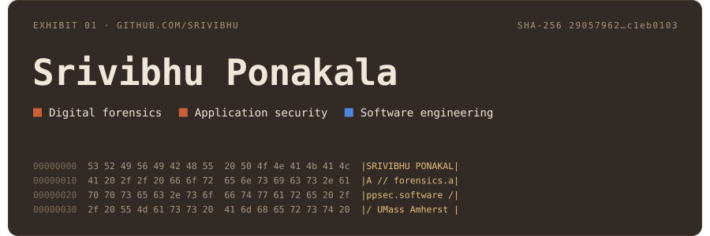

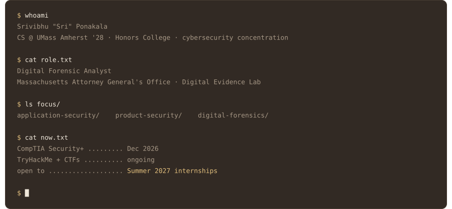

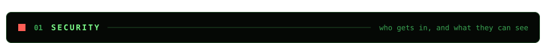

<a href="https://github.com/Srivibhu/hours-tracker">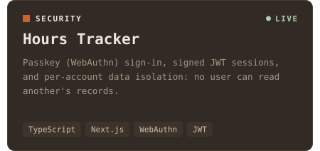</a>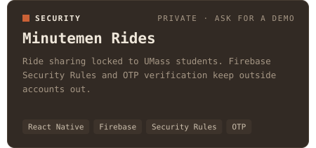

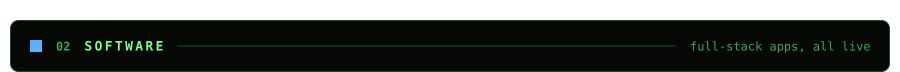

<a href="https://github.com/Srivibhu/TrackGuessr">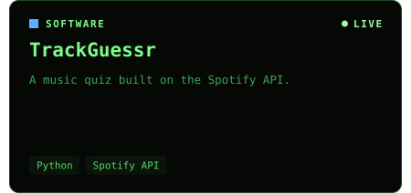</a><a href="https://github.com/Srivibhu/BactiSeeDEMO">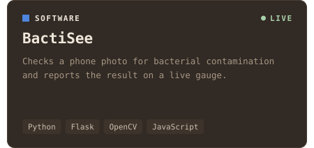</a>

<a href="https://github.com/Srivibhu/daily-brief-app">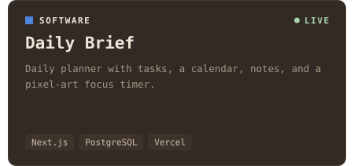</a><a href="https://github.com/Srivibhu/PhotographyPortfolio">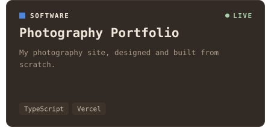</a>

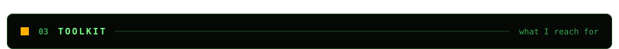

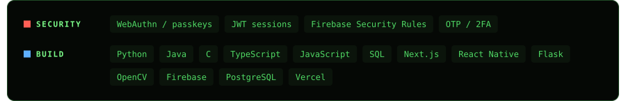

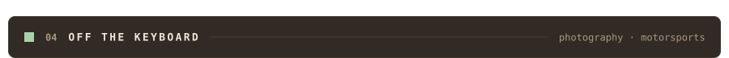

<a href="https://srivibhuportfolio.vercel.app">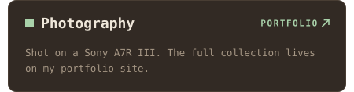</a>

 

