<!-- Images in assets/ come in two versions and swap with GitHub's theme: assets/dark (espresso) and assets/light (cream). -->

<picture><source media="(prefers-color-scheme: dark)" srcset="assets/dark/banner.svg">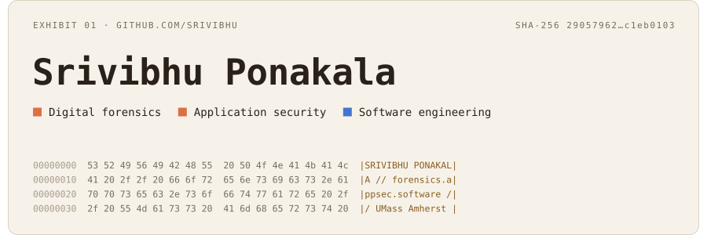</picture>

<picture><source media="(prefers-color-scheme: dark)" srcset="assets/dark/whoami.svg">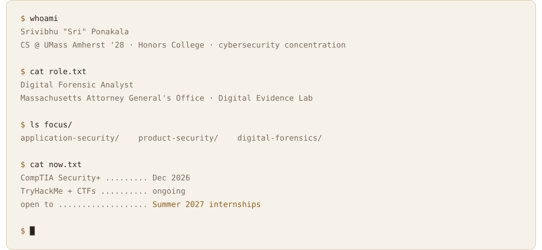</picture>

<picture><source media="(prefers-color-scheme: dark)" srcset="assets/dark/h-security.svg">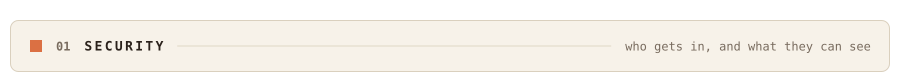</picture>

<a href="https://github.com/Srivibhu/hours-tracker"><picture><source media="(prefers-color-scheme: dark)" srcset="assets/dark/card-hours-tracker.svg">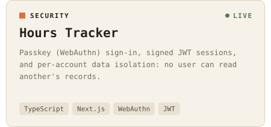</picture></a><picture><source media="(prefers-color-scheme: dark)" srcset="assets/dark/card-minutemen-rides.svg">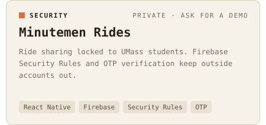</picture>

<picture><source media="(prefers-color-scheme: dark)" srcset="assets/dark/h-software.svg">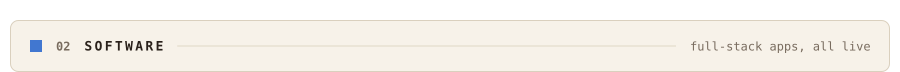</picture>

<a href="https://github.com/Srivibhu/TrackGuessr"><picture><source media="(prefers-color-scheme: dark)" srcset="assets/dark/card-trackguessr.svg">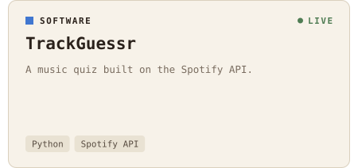</picture></a><a href="https://github.com/Srivibhu/BactiSeeDEMO"><picture><source media="(prefers-color-scheme: dark)" srcset="assets/dark/card-bactisee.svg">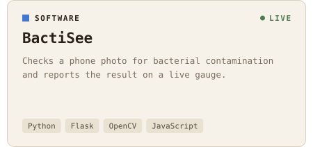</picture></a>

<a href="https://github.com/Srivibhu/daily-brief-app"><picture><source media="(prefers-color-scheme: dark)" srcset="assets/dark/card-daily-brief.svg">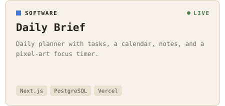</picture></a><a href="https://github.com/Srivibhu/PhotographyPortfolio"><picture><source media="(prefers-color-scheme: dark)" srcset="assets/dark/card-portfolio.svg">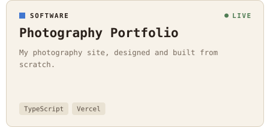</picture></a>

<picture><source media="(prefers-color-scheme: dark)" srcset="assets/dark/h-toolkit.svg">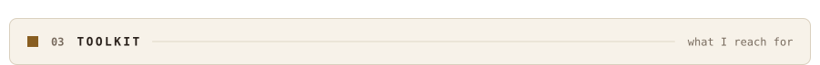</picture>

<picture><source media="(prefers-color-scheme: dark)" srcset="assets/dark/toolkit.svg">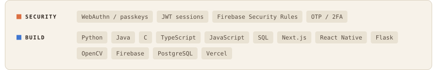</picture>

<picture><source media="(prefers-color-scheme: dark)" srcset="assets/dark/h-offline.svg"></picture>

<a href="https://srivibhuportfolio.vercel.app"><picture><source media="(prefers-color-scheme: dark)" srcset="assets/dark/photography.svg">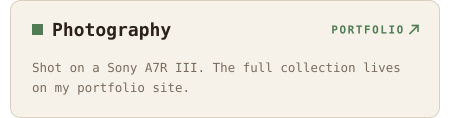</picture></a><picture><source media="(prefers-color-scheme: dark)" srcset="assets/dark/motorsports.svg"></picture>

<a href="https://www.linkedin.com/in/srivibhuponakala"><picture><source media="(prefers-color-scheme: dark)" srcset="assets/dark/btn-linkedin.svg"></picture></a> <a href="https://srivibhuportfolio.vercel.app"><picture><source media="(prefers-color-scheme: dark)" srcset="assets/dark/btn-portfolio.svg"></picture></a>

<picture><source media="(prefers-color-scheme: dark)" srcset="assets/dark/footer.svg"></picture>

